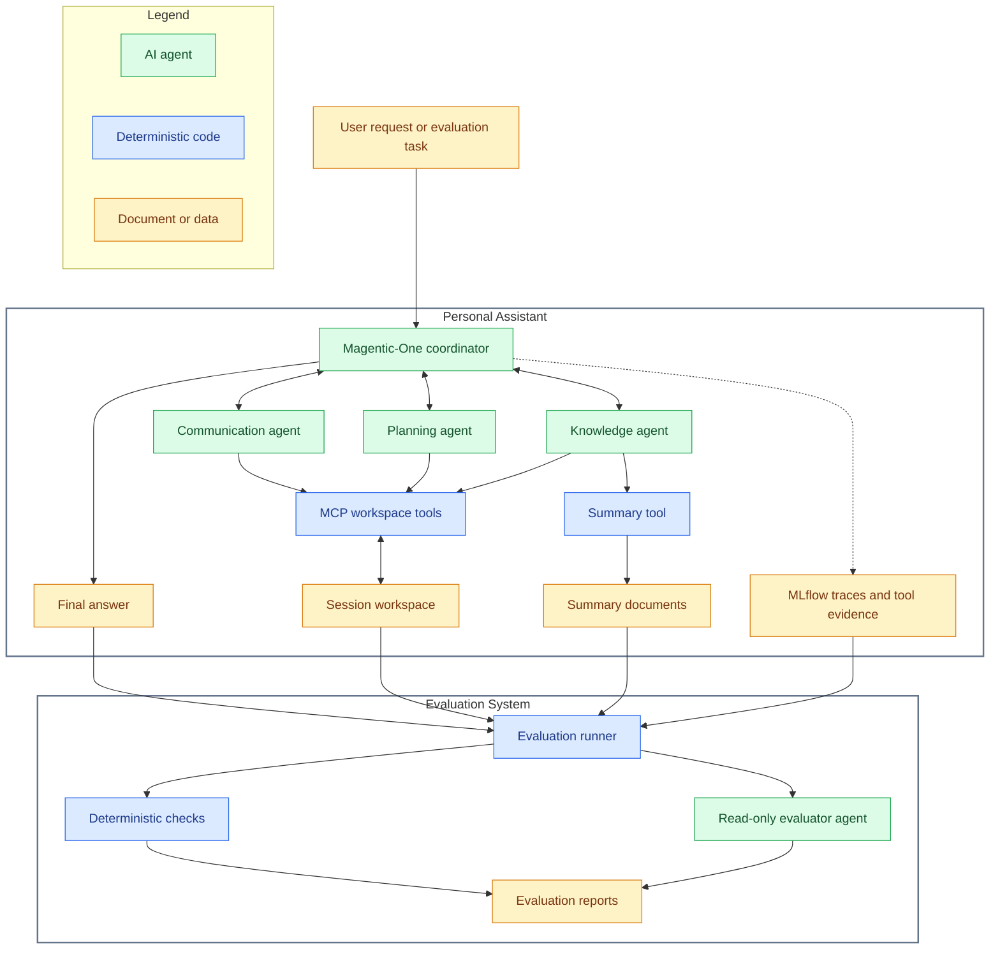

# Personal Assistant and Evaluation

This project contains a multi-agent **personal assistant built with AutoGen's Magentic-One** group chat and an evaluation system including **llm-as-a-judge and deterministic check**. The assistant coordinates specialist agents to answer questions about a local workspace, manage tasks and calendar events, draft emails, and save summaries.

**This repository cannot be run as provided.** It is limited to the author's work; confidential files and supporting components from the original project are intentionally omitted. These include the workspace data, task definitions, MCP servers, shared tools, configuration, and original modules required at runtime. The execution instructions in the documentation assume access to the complete private environment.

## Project overview

The assistant uses a Magentic-One coordinator to delegate requests to three specialists:

- **Communication:** retrieves email and contact information and creates local email drafts.
- **Planning:** retrieves and manages tasks and calendar events.
- **Knowledge:** retrieves notes and files and writes requested summary documents.

Each session uses its own workspace copy. Optional MLflow tracing records model calls and tool evidence for inspection and evaluation.

Evaluation uses two methods:

- **Deterministic checks:** verify expected answer content, tool calls, and workspace changes.
- **LLM-as-a-judge:** reviews whether the requested outcome was fulfilled and the assistant's answer is supported by evidence.

The evaluation system runs task scenarios in fresh sessions and combines deterministic checks of answer content, tool calls, and workspace changes with a read-only LLM-as-a-judge review. A task passes when the deterministic checks pass and the judge does not return `FAIL`; an inconclusive `UNKNOWN` verdict is non-blocking. Evaluation reports and trace exports support analysis of the outcomes.

## Architecture

The diagram shows the complete workflow, including supporting components omitted from this repository.

## Repository contents

| Path | Purpose |
| --- | --- |
| [src/autogen_personal_assistant/](src/autogen_personal_assistant/) | Assistant entry point, specialist team configuration, and tracing. |
| [src/evaluation_agent/](src/evaluation_agent/) | Evaluation runner, deterministic checks, evaluator agent, and report generation. |
| [docs/](docs/) | Detailed descriptions of the assistant and evaluation systems. |
| [results/](results/) | Saved evaluation artifacts, including the [task results report](results/user_tasks_results.md). |

## Detailed documentation

- [AutoGen system description](docs/autogen_system_description.md): assistant architecture, agent responsibilities, tools, session state, tracing, and comparison with the original system.
- [Evaluator system description](docs/evaluator_system_description.md): evaluation workflow, deterministic checks, judge behavior, evidence collection, and reporting.
