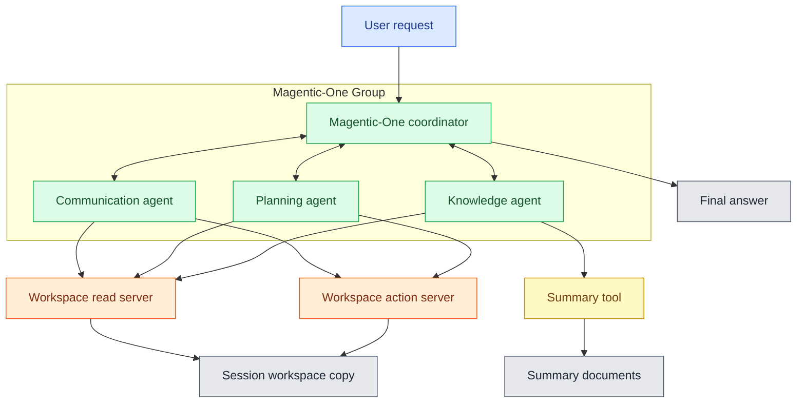

# Autogen System Description

## Overview

This implementation uses AutoGen `MagenticOneGroupChat` to coordinate three specialist
AI agents. It reuses the original MCP servers, tools, Azure configuration,
workspace data, and Task 2 evaluation criteria. All implementation additions are
under `tasks/task_3_agentic_system_implementation/`.

This system is a personal assistant that answers questions about the user's local
workspace and can manage tasks and calendar events, draft emails, and save
summaries. It uses a Magentic-One coordinator and three specialist agents: the
Communication agent finds contact and email information and drafts emails; the
Planning agent retrieves and manages tasks and calendar events; and the Knowledge
agent retrieves notes and files and saves requested summaries.

## Setup and Execution

Make sure to use a virtual environment and install the required dependencies listed in [`requirements.txt`](../../requirements.txt).

Run with:

```bash
# Interactive session; exit or quit ends it.
python tasks/task_3_agentic_system_implementation/main.py

# One request in a fresh session.
python tasks/task_3_agentic_system_implementation/main.py --query "What is Owen Murray's email address?"

# One MLflow trace per request, including in interactive mode.
python tasks/task_3_agentic_system_implementation/main.py --mlflow --verbose

# Evaluate all 10 unchanged tasks with the Task 2 evaluator.
python tasks/task_3_agentic_system_implementation/evaluation/evaluate_assistant.py
```

Options:

- `--query`: run one request in a fresh session.
- `--session`: use interactive mode, even with `--query`.
- `--verbose`: print team messages to stderr.
- `--timeout`: request timeout in seconds (default: 300).
- `--mlflow`: save one trace per request.
- `--trace_dir`, `--mlflow_db`, `--exp_name`, and `--tracking_uri`: configure tracing. Defaults are `tasks/task_3/traces/`, `tasks/task_3/mlflow.db`, and `pa_magentic_one`.

Inspect local traces with:

```bash
mlflow ui --backend-store-uri sqlite:///tasks/task_3/mlflow.db --port 5000
```
## Main Components

| Component | Type | File name | Responsibility |
| --- | --- | --- | --- |
| Session and team runner | Code | `main.py` | Accept user requests, create a session workspace, initialize tools and the team, and run each request. |
| Team configuration | Code | `team.py` | Configure the model client, connect to the existing MCP servers, allocate tools, and create the Magentic-One team. |
| Magentic-One coordinator | AI Agent | AutoGen `MagenticOneGroupChat` | Coordinate the shared conversation, select specialists, track progress, and produce the final answer. |
| Communication agent | AI Agent | `team.py` | Retrieve email and contact evidence and draft local emails using `search_emails`, `search_contacts`, and `draft_email`. |
| Planning agent | AI Agent | `team.py` | Retrieve and manage tasks and calendar events using `search_calendar`, `search_tasks`, `create_task`, `update_task`, `create_calendar_event`, and `update_calendar_event`. |
| Knowledge agent | AI Agent | `team.py` | Retrieve notes and task files and save requested summaries using `search_notes`, `read_task_file`, and `write_personal_summary_document`. |
| Workspace-read<br/>MCP server | MCP server | `workspace_server.py` | Expose the read tools through a local subprocess using standard input/output transport. |
| Workspace-action<br/>MCP server | MCP server | `action_server.py` | Expose the action tools through a local subprocess using standard input/output transport. |
| Local summary tool | Tool | `local_tools.py` | Write summary files to the `outputs/` directory. |
| Workspace | Folder | `workspace/` | Seed JSON and Markdown workspace data that is copied into a session-specific workspace. |

## Architecture

### Workflow

The Magentic-One coordinator divides each request into specialist tasks and selects
the next agent based on the information or action required. Communication handles
email and contact work, Planning handles tasks and calendar changes, and Knowledge
handles notes, files, and summaries. The coordinator combines their results into the
final response.

### Specialist prompt responsibilities

Each specialist receives a role-specific system prompt in addition to shared rules
for the workspace date, evidence-based claims, and explicit-only actions. Communication
uses full-name, name-fragment, and topic searches for email evidence and creates local
drafts only when requested. Planning confirms the target record before a task or
calendar change and updates only requested fields. Knowledge searches notes, reads
explicitly named task files, and creates a summary document only when the user or that
requested file requires one. The coordinator's final-answer prompt limits the response
to verified, requested facts and actions, reconciles required specialist handoffs, and
excludes inferred side effects or unrequested follow-up work.




AutoGen's built-in manager coordinates the shared conversation, selects specialists,
and produces the final answer. Specialists have only their assigned tools. The manager has no workspace tools.

### Communication

AutoGen's [Magentic-One group chat](https://microsoft.github.io/autogen/stable/user-guide/agentchat-user-guide/magentic-one.html) shares structured messages and agent events through the group-chat runtime. The orchestrator maintains a message thread of typed AutoGen message objects and converts the relevant messages into model context when making LLM calls. Agent responses are added to the message thread and broadcast through the group chat, allowing the orchestrator to track progress and select the next agent.


[AutoGen MCP tool adapters](https://microsoft.github.io/autogen/stable/reference/python/autogen_ext.tools.mcp.html)
call local subprocesses over standard input/output using MCP JSON-RPC. Calls contain
a tool name and JSON arguments, and servers return text content. Read and action
servers use session-workspace JSON files, while the summary tool writes Markdown to
`outputs/`. 

## Memory and State

The application keeps request state and conversation history in memory and stores workspace data on disk. It also saves summary documents on disk, but does not automatically use them as context for later model decisions.

| Information | Used by the system? | Memory/Disk | Implementation | Contents | Lifetime |
| --- | --- | --- | --- | --- | --- |
| Current request and team ledgers | Yes | Memory | AutoGen `MagenticOneGroupChat` context and ledgers | The current request, shared team conversation, and Magentic-One planning state. | Reset for every request. |
| Session history | Yes | Memory | `PersonalAssistantSession.history` Python list of dictionaries | Completed user and assistant exchanges. | Retained for the running session and supplied as context to later requests. |
| Session workspace | Yes | Disk | Session directory referenced by `PersonalAssistantSession.workspace` | A copy of `workspace/`; task, calendar, and draft changes. | Retained across requests in the same session. |
| Summary documents | No | Disk | Markdown files written by `write_personal_summary_document` | Files written to the shared `outputs/` directory. | Shared across sessions; not automatically added to agent context. |

`MagenticOneGroupChat` holds the working state for a single request. Its shared conversation and planning ledgers allow the coordinator and specialists to use the current request and the results produced so far. The team is reset before every request, so this state does not persist to the next request.

Session history is separate from the request state. In interactive mode, the application appends each completed user and assistant exchange to `PersonalAssistantSession.history`, then includes that history in the next request's task context. Failed requests are not stored.

At the beginning of a session, the application copies the seed `workspace/` directory into a session-specific directory. Both local MCP servers receive that directory through `PA_WORKSPACE_DIR`, so changes made by the agents remain available to later requests in the same session.

Summary documents are an exception to session workspace isolation: the local summary tool saves them in the repository-level `outputs/` directory. This directory is shared across sessions, but its files are not automatically used by the system.


## Observability and Evaluation

Each request produces one `personal_assistant_task` MLflow trace with model calls and
tool evidence. The evaluator reuses Task 2's checks and runs every task in a fresh
workspace, its judge is separate from the assistant trace.

Evaluator-agent reviews use `PASS`, `FAIL`, and `UNKNOWN` verdicts. `PASS` and
`UNKNOWN` are non-blocking for the overall result when deterministic checks pass;
only `FAIL` blocks the result. A judge transport or JSON-parsing failure is recorded
as `UNKNOWN`, preserving the distinction between incomplete evaluation evidence and a
demonstrated task failure.

Run the evaluator from the repository root:

```bash
python tasks/task_3_agentic_system_implementation/evaluation/evaluate_assistant.py
```

Artifacts are saved under `tasks/task_3_agentic_system_implementation/evaluation/`:

- `user_tasks_results.md` and `.csv`: the original report format.
- `results.json`: full results, including errors, trace counts, and judge evidence.
- `mlflow/task_<id>_*/`: one exported assistant trace for each task.
- `mlflow.db`: local tracking store for the evaluation.

Reports are written after each case without overwriting Task 2 reports.

## Comparison with the Original System

| Aspect | Provided LangGraph assistant | Task 3 |
| --- | --- | --- |
| Coordination | Custom JSON router in a graph | Magentic-One task/progress ledgers and participant selection |
| Specialization | Reader, action, writer | Communication, planning, knowledge |
| Information sharing | Router receives worker summaries | Shared group conversation managed by AutoGen |
| Conversation history | Stored but not consumed | Completed exchanges supplied to later requests |
| Execution context | Fresh worker per delegation | Participants share current-request context; reset between requests |
| Observability | Multiple traces may be exported for a request | One request root with model calls and tool evidence |
| Tools and durable state | Existing MCP servers and shared summary output | Same implementations and storage behavior |

The systems use the same workspace and core tools but divide responsibility
differently. The original assigns agents by privilege level—reader, action, and
writer—while the new system assigns them by field of expertise: Communication,
Planning, and Knowledge. Write access is therefore distributed to the domain agents
that need it rather than concentrated in one action agent.

Their orchestration also differs. The original orchestrator returns a JSON decision
that selects one worker at a time and receives its summary before routing again.
Magentic-One instead coordinates a shared group conversation using task and progress
ledgers, selecting the participant best suited to the next subtask.

The original implementation is based on LangGraph and a custom graph workflow; the
new implementation is based on AutoGen's Magentic-One group-chat pattern. Both
retain session-scoped workspace changes, but AutoGen makes specialist findings
available to the rest of the current request's conversation.


## References

- [AutoGen Magentic-One](https://microsoft.github.io/autogen/stable/user-guide/agentchat-user-guide/magentic-one.html)
- [AutoGen MCP adapters](https://microsoft.github.io/autogen/stable/reference/python/autogen_ext.tools.mcp.html)
- [AutoGen LangChain adapter](https://microsoft.github.io/autogen/stable/reference/python/autogen_ext.tools.langchain.html)
- [MLflow AutoGen tracing](https://mlflow.org/docs/latest/genai/tracing/integrations/listing/autogen.html)


## Use of Generative AI

Codex was used to inspect the existing code, draft the AutoGen
implementation, and draft this documentation.
ChatGPT was used to ask questions about the code and relevant material, as well as for linguistic editing.
